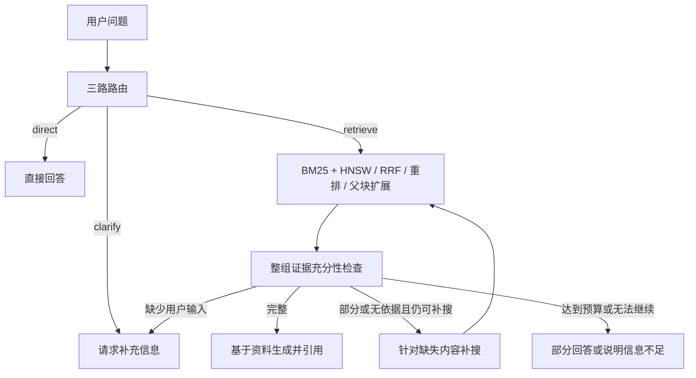

# Agentic RAG：技术文档问答

基于 LangGraph 的技术文档问答项目，结合本地 BGE、混合检索、交叉编码器重排、语义切分与父子块检索。Agent 根据整组资料是否足以回答原问题，选择生成、定向补搜、部分回答或请求补充信息。

当前运行 **v2 流程**。v3 的固定要点和严格摘录校验在开发集上出现退化，已回退；实验过程与问题定位保留在[失败案例复盘](docs/agentic_rag_v3_failure_case.md)中。

## 核心能力

- **文档处理：** PDF 文本与来源页码提取，结构父块、语义子块、跨页来源定位。
- **检索：** BM25 与 FAISS HNSW 双路召回，经加权 RRF 融合、BGE reranker 重排后扩展父块。
- **Agent：** 检索 / 直接回答 / 澄清三路路由，整组证据充分性检查，缺失内容定向补搜与有限重试。
- **工程与评测：** 本地向量化、索引指纹与缓存、上下文预算、节点 trace、120 题开发集和 200 题测试集。



## 快速开始

以下命令从项目根目录执行。已验证环境为 Python 3.10、PyTorch 2.13.0+cu126、Transformers 4.57.6。依赖清单按本地已安装版本整理，未另行验证全新环境安装。

### 1. 安装依赖

```powershell
python -m pip install -r requirements.txt
```

如需 CUDA，先安装适合本机的 PyTorch 构建，再安装其余依赖。未安装 CUDA 构建时，本地模型可使用 CPU；具体性能取决于设备。

### 2. 配置密钥

首次使用复制模板；已有 `.env` 时编辑原文件即可：

```powershell
Copy-Item .env.example .env
```

填写 `ZHIPUAI_API_KEY` 用于问答；选用 DeepSeek 裁判时填写 `DEEPSEEK_API_KEY` 和相应接口地址。Embedding 与 reranker 在本地执行。

配置集中在 [rag_core/config.py](rag_core/config.py)，所有环境变量、默认值和优先级见[配置说明](docs/configuration.md)。当前沿用 `.env` 覆盖同名系统环境变量的行为。

### 3. 放入 PDF 并准备索引

将可提取文字的 PDF 放入 `knowledge_db/book/`。使用内置评测集时，需提供与标注匹配的四本资料，文件名与版本要求见[知识库说明](knowledge_db/README.md)。

```powershell
python -m rag_core.prepare_index --strategy semantic
```

这一步只准备本地索引，不调用问答模型或裁判。首次运行会下载模型权重并完成向量化；缓存命中后直接加载。

### 4. 运行问答

```powershell
python rag.py
```

输入 `q` 退出。已有 Python / Notebook 进程在切换版本后需重启，以加载新代码。

## 评测与测试

仅校验开发集格式及来源文件是否存在，不调用模型：

```powershell
python evaluation/evaluate.py --dataset evaluation/datasets/dev.jsonl --validate-only
```

运行 120 题 Agent 开发集评测与裁判：

```powershell
python evaluation/evaluate.py --dataset evaluation/datasets/dev.jsonl --mode agent --judge --judge-model deepseek-flash --warmup-rerank
```

裁判模型名需与实际接口支持的名称一致。在线评测会产生问答和裁判调用。当前 `--mode` 支持：

| 模式 | 内容 |
|---|---|
| `retrieval` | BM25、dense、hybrid、rerank 检索对照 |
| `agent` | 完整 Agent |
| `both` | 四路检索与 Agent；120 道题共 600 条记录 |

未指定 `--dataset` 时使用 6 题 smoke 集。结果写入 `evaluation/reports/`；指标定义、失败统计与使用方法见[评测说明](evaluation/README.md)。

离线测试不调用付费模型：

```powershell
python -m unittest discover -s tests
python -m unittest discover -s evaluation -p "test_*.py"
```

## 已完成实验

四本书构成 2006 个父块、4676 个检索子块，向量维度为 768。以下为 2026-10-22 的历史开发集结果：

| 实验 | 结果 | 口径 |
|---|---|---|
| hybrid → rerank | 页级 Hit@5：69.6% → 76.1% | 92 道有标注证据页的知识题 |
| hybrid → rerank | MRR@5：0.552 → 0.651 | 同一批知识题 |
| v2 Agent | 裁判正确率 99/120，82.5% | `deepseek-flash` 自动评分 |
| v3 Agent | 裁判正确率 37/120，30.8% | 同题对照，已撤回 |

这些是开发集结果；页命中不等于证据完整或答案正确，自动裁判也不能代替独立人工核验。回退和仓库整理未重新运行在线质量评测。

指标出处见[项目与实验材料](docs/resume_project.md)、[失败实验统计](docs/agentic_rag_v3_failure_metrics.json)及[回退记录](docs/workflow_rollback_20261024.md)。完整逐题报告保留在本地，默认不提交。

## 目录

```text
rag.py                     交互入口与评测接口
file_loader.py             PDF 加载
rag_core/
  config.py                配置常量
  models.py                问答与本地向量模型工厂
  structure.py / chunking.py
                           结构恢复与语义切分
  indexing.py / store.py    检索器与索引持久化
  rerank.py / parent_retriever.py
                           重排与父块扩展
  prompts.py / graph.py    提示词、三路路由与证据检查
  structured.py / telemetry.py
                           输出解析与节点追踪
evaluation/                评测脚本、数据集与指标测试
tests/                     核心功能离线测试
docs/                      配置、设计和实验记录
notebooks/                 原始教程学习笔记
knowledge_db/book/         本地 PDF 输入，不提交
.env.example               无密钥的配置模板
```

模型权重、向量索引、PDF、`.env`、完整运行报告及本地工作备份已列入 Git 忽略规则。Notebook 保留学习代码，已清除执行输出；它们与当前应用入口分开，独立依赖未混入主项目依赖清单。

## 进一步阅读

- [配置参数](docs/configuration.md)
- [当前 Agent 流程](docs/agent_workflow.md)
- [语义切分与父子块检索](docs/chunk_optimization.md)
- [本地 BGE 与索引缓存](docs/local_bge.md)
- [开发集与测试集](evaluation/datasets/README.md)
- [失败实验与问题定位](docs/agentic_rag_v3_failure_case.md)

## 项目来源

项目基于 [LangChain RAG From Scratch](https://github.com/langchain-ai/rag-from-scratch) 学习与迭代。原教程 Notebook 保留于 `notebooks/`；当前应用的主要工作包括本地 BGE、语义切分与父子块检索、证据驱动 Agent、缓存及评测体系。
