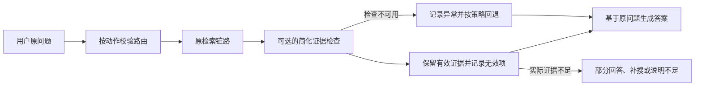

# 失败案例复盘：严格证据校验引发 Agentic RAG 过度拒答

整理日期：2026-10-22。

当前状态（2026-10-24）：已完成实验对比和故障定位，并将运行代码回退到 `run_20261022T051059_048567Z` 对应的 v2，详见 [回退记录](workflow_rollback_20261024.md)。下文修正方案尚未实施，回退后未重新进行在线质量评测。该案例适用于面试中的“项目遇到过什么问题”“如何定位效果下降”“如何验证 Agent 的价值”等问题。

## 1. 这个案例说明了什么

为提高答案可追溯性，在原有 Agent 中同时加入固定待答要点、逐点原文摘录、严格 JSON 输出和提前停止规则。真实模型经常无法满足这些要求，而程序将局部格式或摘录问题升级成整题失败，导致误拒答和延迟大幅增加。

这里需要区分三个问题：输出格式是否可解析、证据是否真实存在、证据是否支持结论。严格校验格式和摘录存在性，不能自动保证事实正确；程序还需要合理处理局部错误与检查不可用的情况。

## 2. 实验目标与条件

原系统已经有检索 / 直接回答 / 澄清三路路由、整组证据检查和按缺失内容补搜。改造目标是减少证据检查过程中添加额外要求、错误引用以及无效补搜，同时让答案更容易核查。

两轮使用相同的 120 题开发集、glm-4-flash 问答模型、deepseek-flash 裁判和本地 BGE 索引配置。知识库包含 4 本技术书籍，2006 个父块、4676 个子块；检索使用 BM25、FAISS HNSW、加权 RRF、BGE reranker 与父块扩展。

| 本轮变化 | 原本希望获得的收益 |
|---|---|
| 路由时拆分固定待答要点，分配 r1、r2 等 ID | 后续检查保持问题范围一致 |
| 每个支持结论提供资料编号和连续原文 | 发现虚构摘录和引用错位 |
| 根据逐项支持结果计算 complete / partial / none | 使完整性判断可追溯 |
| 生成答案必须满足逐要点 JSON 和引用映射要求 | 防止漏答和引用错配 |
| 无新上下文或无覆盖进展时停止补搜 | 控制重复调用和延迟 |
| 修复重试附带上次输出和校验错误 | 提高结构化结果的恢复能力 |
| 新增普通 RAG 对照入口和诊断字段 | 衡量 Agent 相对单次检索生成的收益 |

此次同时改变了多个环节，因此属于完整流程版本对比，不能把整体差值精确归因于某个单独机制。

## 3. 实验结果

| 指标 | 上一版 Agent | 本轮普通 RAG | 本轮 Agent |
|---|---:|---:|---:|
| 裁判正确率，120 题 | 99/120，82.5% | 61/120，50.8% | 37/120，30.8% |
| 知识题正确率，92 题 | 75/92，81.5% | 38/92，41.3% | 14/92，15.2% |
| 内部流程失败题数 | 3 | 29 | 69 |
| 可回答题误拒答，96 题 | 6/96，6.25% | 27/96，28.13% | 74/96，77.08% |
| P50 问答延迟 | 29.5 秒 | 6.4 秒 | 46.8 秒 |
| P95 问答延迟 | 64.9 秒 | 11.2 秒 | 107.0 秒 |
| 首次上下文页级 Hit@5，92 题 | 75.0% | 76.1% | 75.0% |

Agent 总正确率下降约 51.7 个百分点；逐题配对中，67 道原来正确的题变错，5 道原来错误的题变对。新增检查没有达到预期目标。

注意指标口径：

- 表中的“正确”是同一裁判模型判断的结果，不是独立人工审核结果。
- 120 题中包含知识问答、直答、澄清和不可回答题；知识题分母为 92，可回答题分母为 96。
- 报告里的“120/120 成功”表示顶层执行返回了结果，内部错误可能被包装成拒答；不能解释为业务成功率 100%。
- P50/P95 不含初始化和裁判耗时。
- 本轮普通 RAG 自身有 29 次生成校验失败，其结果不能视为一个充分验证的普通 RAG 能力基线。

## 4. 如何定位问题

### 4.1 先核对条件，排查检索退化

核对两轮 summary 中的数据集哈希、模型配置、Judge 和索引 CACHE_KEY，确认这些条件一致。

随后从 details.jsonl 的首次 retrieve 节点读取 pool，复用评测器的页级计分函数重新计算指标。新旧 Agent 首次上下文的 Hit@5 均为 75.0%，Recall@5 均约 70.29%；92 道知识题中有 91 道的首次上下文 chunk ID 列表完全一致。

本轮有 64 道知识题发生内部流程失败，其中 52 道在首次上下文中至少命中了一个标注证据页。这说明主要故障集中在检索之后，但页命中本身仍不能证明上下文足以回答完整问题。

报告中最终上下文 Hit@5 降为 15.2%，还受到拒答时清空 documents 的影响。应该分别观察初始检索池、生成输入和最终保留上下文。

### 4.2 按节点统计错误与耗时

Agent 的 69 道内部流程失败包括：

| 最终失败环节 | 题数 | 进一步诊断 |
|---|---:|---|
| 证据检查 | 61 | 最后一次错误：52 次原文摘录不匹配、6 次 schema 错误、3 次超时 |
| 答案生成校验 | 8 | 最后一次错误均涉及回答要点 ID 集合不满足要求 |

另有 13 道题路由解析最终失败，随后进入保守检索。这些题可能继续发生上述失败，不能把 13 与 69 直接相加。

证据检查执行了 129 次，实际发起 199 次模型调用，累计耗时占 Agent 总问答耗时约 76.9%。无新增上下文而跳过检查的次数为 0，预期的该项节省在本轮没有出现。

### 4.3 检查典型案例，而不只看均值

| 题号 | 观察到的现象 | 暴露的问题 |
|---|---|---|
| dd-01 | 用户只打招呼；模型选择 direct，却因缺少 clarification_question 失败，转为检索并最终拒答 | 无关字段缺失破坏正确路由 |
| dd-03 | 简单加法请求同样因路由字段不完整而进入检索 | 需要检查协议兼容性，不能仅增加特定题目的规则 |
| r03-2 | 原问题同时问策略名称和用途，拆分结果只剩“策略名称” | 固定要点可能漏掉原始子问 |
| r02-2 | 询问两个限制分别属于什么方面，却新增“对算法设计与实现的影响” | 拆分结果扩大了用户问题范围 |
| x06-1 | 比较表格预处理与 PDF 清洗，却要求寻找“房价教材中的 PDF 清洗步骤”等额外内容 | 错误分解导致不必要的证据缺口 |

具体错误摘录和要点列表保存在配套的 [诊断数据](agentic_rag_v3_failure_metrics.json) 中。

## 5. 根因及证据边界

### 根因一：提示词与 schema 存在矛盾

RouteDecision 将 clarification_question 定义为必填字符串；提示词却要求只在 clarify 时填写。模型返回正确 direct 动作仍可能被整体拒绝，触发错误的回退路径。这是已确认的协议设计问题。

### 根因二：局部错误触发整题拒答

validate_assessment 对任意一条不匹配的引用抛出异常；整份检查重试仍失败后，graph 进入 error / abstain。局部无效引用、检查不可用和整题没有答案之间缺乏合理的分级处理。

原文匹配已经执行 NFKC 和空白归一化，因此不能简单归因于 PDF 换行。现有日志没有完整保存失败模型输出，尚不能逐条区分改写、选错资料、截断或编造。已确认的是匹配失败的规模及其触发整题失败的路径。

### 根因三：未经充分验证的要点拆分成为硬约束

程序能保证后续不修改要点列表，却不能保证该列表完整、准确。漏问会让系统过早宣称完整，加问会产生额外补搜和拒答。单纯固定 ID 无法解决语义规划质量问题。

### 根因四：答案内容与输出包装过度绑定

普通 RAG 只有一个 r1，仍要求模型按精确的 points 结构输出；Agent 还要求恰好覆盖已支持 ID 的集合。格式和集合不满足时整段回答被替换为失败说明。该设计同时影响了实验组和对照组。

### 验证过程的缺口

190 项离线测试使用假模型输出，验证了状态转换、校验边界和异常处理；本地集成检查验证了真实检索链路，但问答模型仍是替身。这些结果没有覆盖真实模型遵循新协议的能力、要点拆分质量和端到端回答效果。

本次还同时修改多个关键环节，使后续难以精确分离各项影响。模型能力与协议复杂度的匹配也需要实验验证，目前不能把全部问题简单归因为模型弱。

本轮 Grounded 和引用支持率均为 85.7%，但相应评分覆盖只有 21 个回答。大量拒答不进入这些指标的分母，必须同时报告回答覆盖、误拒答和内部失败，避免只展示保留下来的少数答案。

## 6. 如何修正：按阶段实施，每步单独验证

以下是修正计划，不代表已经完成。

| 优先级 | 修改内容 | 验证重点 |
|---|---|---|
| P0 | 保存当前失败版本与报告；给普通 RAG 和 Agent 共用简化生成协议，避免强制逐要点 JSON 导致整题拒答 | 普通 RAG 是否能稳定回答；格式失败是否显著减少 |
| P1 | 路由按动作校验必需字段；direct / retrieve 的澄清字段缺省补空，clarify 仍须有具体追问 | 正确动作不会因无关空字段缺失而被改成检索 |
| P2 | 程序预先给原文句段编号，模型选择证据 ID；程序回填原文与来源 | 减少复制原文造成的格式负担，保持引用可追溯 |
| P3 | 引用逐条、要点逐项校验；记录失效项，保留其他有效项；区分支持、缺证据、检查不可用 | 一条坏引用不再清空全部有效结果；错误证据也不能被默认为有效 |
| P4 | 简单问题保留原问题，多问只拆明确子问；对拆分质量单独抽查，错误分解不能代替原问题 | 不漏问、不添加原问题未要求的内容 |
| P5 | 将检查与补搜作为可开关的增量机制，分别控制格式修复、检索轮次和总耗时 | 用消融确认额外检查是否带来足够收益 |

实施细节：

1. **保留语义校验，减少无关包装要求。** 可以安全补齐空的说明字段，不能凭空补出结论、证据或未知路由动作。普通 RAG 的引用编号仍应对应真实上下文。
2. **证据编号由程序产生。** 每个句段保留 chunk ID、字符范围、页码和原文；公式、代码可作为完整段落编号。模型只选择本轮提供的 ID，程序验证 ID 存在并映射原文。选择了真实 ID 仍不保证语义支持，需继续做质量评测。
3. **回退必须保留诊断。** 若证据检查不可用，可尝试一次有记录的普通 RAG 回退，基于实际检索资料回答；资料不足时仍说明不足。回退回答不能标为“已通过证据校验”，并应记录 fallback_used、原始错误及其质量和开销。
4. **生成与覆盖检查分开。** 保留用户原始问题作为最终任务，允许自然语言组织答案；要点漏答可以记录或局部修复，避免仅因 ID 包装不一致丢弃整个答案。
5. **改善失败日志。** 保存适当长度的原始模型输出、解析结果、具体失败字段、最终处理动作及截断标记，便于复现。这里记录的是请求响应内容，不记录凭证；日志权限按知识库资料管理。

可以用下面的控制流程表达修正方向：

## 7. 怎样验证修正有效

先固定模型、索引、数据集、上下文预算和 Judge，仅改变工作流策略。

第一步选约 20 道开发题做真实模型回归，同时包含本轮失败案例与上一版正常案例。覆盖直接任务、澄清/无答案、概念或改写、多证据和跨书问题；不要只挑最容易修复的格式错误题。对缺省字段、证据 ID 越界、单条坏证据、检查超时等情况补充离线回归。

小样本的用途是验证协议和故障处理。对重复出现的真实模型协议故障先定位修复，再扩大到 120 题开发集；不能用这 20 题宣称整体正确率提升。

推荐的逐步对照：

| 实验 | 新加入的变量 |
|---|---|
| A0：可用的普通 RAG | 相同检索器和简化生成协议，作为参照 |
| A1：三路路由 + A0 | 检查分流是否减少不必要检索，同时保持知识问答质量 |
| A2：A1 + 简化证据检查 | 检查是否改善有依据回答与拒答判断 |
| A3：A2 + 有限补搜 | 检查困难问题增益是否值得额外延迟 |
| A4：A3 + 固定要点 / 无进展停止 | 分别开关，验证规划与停止规则各自的作用 |

比较 A2/A3 的知识问题时，要让进入检索的题使用同一生成协议；存在上下文或调用预算差异时明确记录。对失败案例逐题配对分析，不只比较总体均值。

每轮同时报告：整体与知识题正确率、多证据/跨书分组表现、可回答题误拒答、不可回答题行为、内部失败率、裁判覆盖数、引用支持与回答覆盖、P50/P95、调用量及检查/回退耗时。首次检索指标与最终上下文指标分开。

若需要宣称稳定提升，应在相同条件下重复关键对照，结合题级不确定性与人工抽查。流程冻结后再运行 200 题测试集；不使用测试答案反向制定路由或规则。任何修正后的提升数字都必须来自新的实际报告。

## 8. 面试可以怎么回答

### 当前可用的一分钟版本

> 我遇到过一次比较明显的 Agent 流程退化。当时为了提高答案可追溯性，我加入了固定待答要点、原文摘录校验和结构化回答要求，预期是减少错误引用和无效补搜。结果在同一份 120 题开发集、相同模型和裁判条件下，正确率从 82.5% 降到 30.8%，P50 从约 29.5 秒升到 46.8 秒。
>
> 我先检查检索环节，发现新旧首次检索命中率都是 75%，于是按节点分析 trace，定位到大量证据匹配和格式校验失败。比如模型已经正确选择直接回答，但缺少一个此时用不到的澄清字段，就被程序转进检索并最终拒答。
>
> 这让我意识到，格式正确、证据存在和结论正确是不同的问题，局部校验错误不能轻易变成整题拒答。目前我已经完成定位，接下来会简化协议、让程序提供可选择的证据编号，并保留局部有效结果，再用小规模真实回归和逐项消融验证。修复后的效果还没有结论，我不会提前把方案当成收益。

### 面试官追问：你怎么确定不是检索变差？

> 我核对了数据集哈希、模型和索引配置，然后用 trace 中首次检索的上下文重新计分。新旧 Agent 的页级 Hit@5 都是 75%，92 道知识题中有 91 道的首次上下文 ID 列表完全一致。最终命中率下降还受拒答后清空上下文影响。所以我把主要排查范围放在检索之后，但没有把页命中当成证据一定充分。

### 面试官追问：为什么加了校验反而更差？

> 校验本身有价值，但我把格式错误、局部引用失败和整题无法回答处理得过于接近，且过度依赖模型稳定输出复杂结构。一条摘录失败就可能丢掉全部检查结果。修正重点是缩小失败影响范围，让确定性的映射由程序完成，而不是简单取消所有校验。

### 面试官追问：为什么单元测试没发现？

> 当时的测试主要使用假模型，覆盖了合法输出、非法输出和条件分支，实际验证的是状态机按设计执行。真实模型是否经常产生合法输出、要点拆分是否正确，需要小规模真实调用与端到端评测。后来这轮实验暴露了测试覆盖层次的不足。

### 面试官追问：换一个更强的模型能不能解决？

> 更强模型可能提高协议遵循能力，但这里已有确定的接口矛盾和失败放大问题。我会先修这些问题，再单独比较模型选择的收益与成本，否则很难分清提升来自模型还是流程，也可能保留本来可以消除的程序错误。

### 面试官追问：你最后解决了吗？

> 当前已经定位了主要故障，并明确了分阶段修正与验证方案，修复效果尚未验证。已确认的结论是首次检索保持稳定，主要失败集中在检查和生成阶段。完成修复后，我会用相同开发集与裁判给出前后结果，并在冻结后用测试集验证。

修复完成后，才能将最后一段更新为：“我先实施了哪些变更，再通过哪些对照，实测正确率 / 误拒答 / 延迟变为多少。”在得到报告前，不填写预计提升数字。

### 面试官追问：这个失败带来了什么经验？

> 我会把每个 Agent 节点都当成有成本、也可能出错的组件，分别验证它的收益。程序负责确定性的解析、编号和映射，模型承担语义判断；解析失败、证据不足、结论错误分别记录。开发上先做小规模真实回归，再逐项加入机制，最后用完整评测判断质量与延迟的取舍。

## 9. 简历和面试材料如何使用

该案例适合放在面试讲述、项目 README 的实验复盘或个人技术文章中。简历的有限篇幅仍优先展示已有可核实成果；如强调诊断能力，可写：

> 基于逐题 trace 分离检索与工作流故障，定位证据匹配、结构化协议及错误分解导致的过度拒答，制定分阶段修正和消融验证方案。

目前只能写“定位 / 制定方案”，不能写“已解决过度拒答”或“将正确率恢复到某值”。

## 10. 可追溯材料

- 上轮完整报告：`evaluation/reports/run_20261022T051059_048567Z/report.md`。
- 本轮完整报告：`evaluation/reports/run_20261022T123627_433409Z/report.md`。
- 原始逐题明细：`evaluation/reports/run_20261022T123627_433409Z/details.jsonl`。
- 本文重算指标、报告哈希、典型案例：[agentic_rag_v3_failure_metrics.json](agentic_rag_v3_failure_metrics.json)。
- 本次失败实验的流程说明：[workflow_v3.md](workflow_v3.md)；当前运行设计见 [v2 流程](agent_workflow.md)。
- v3 的关键实现为 `prompts.py`、`evidence.py`、`graph.py`、`structured.py`。失败版本已归档于本地 `.work_backups/workflow_v3_rollback_20261024T064422Z/`；当前 `rag_core/` 是恢复后的 v2，不应将其当作 v3 源码。

以上完整报告和归档源码仅保存在本地，不随仓库发布；公开的重算统计和报告哈希见本节 JSON。最初撰写复盘时仅新增文档与诊断数据，后续回退记录已在文首单独标明。
