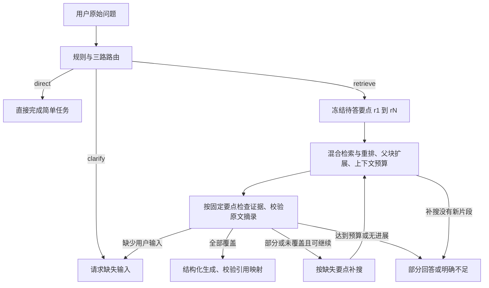

# Agent 问答流程 v3

状态更新（2026-10-24）：本版本因开发集表现退化已撤回，正文保留为历史实验记录；其中的普通 RAG 入口、`--mode compare` / `rag` 和新增校验字段不属于当前运行版本。当前使用 [v2 流程](agent_workflow.md)，备份位置与验证结果见 [回退记录](workflow_rollback_20261024.md)，退化原因见 [失败案例复盘](agentic_rag_v3_failure_case.md)。

2026-10-22：在现有三路路由、整组证据检查和补搜流程上，增加固定待答要点、原文摘录校验、结构化答案约束与无进展停止机制，同时提供普通 RAG 的端到端对照入口。

开发依据是 `evaluation/reports/run_20261022T051059_048567Z`，其中 Agent 在 120 道 dev 题上裁判正确 99 道，P50 约 29.5 秒、P95 约 64.9 秒，另有 3 次证据检查内部失败。检查节点耗时占 Agent 累计耗时约 51.7%。这些是改造前数据，不能当作 v3 的效果。

本次保留 BGE-base 中文模型、四书知识库、语义切分、父块扩展、HNSW、混合检索与 rerank 配置。主要改动集中于 `rag_core/graph.py`、`prompts.py`、`evidence.py`、`structured.py` 及评测入口。

## 当前流程



### 1. 固定问题要点

路由模型在同一次调用中，根据原问题列出 1～8 个待回答要点，由程序分配 `r1`、`r2` 等 ID。各轮证据检查都使用同一列表，不允许模型根据检索结果新增、删除或更换要点。路由解析失败会携带错误反馈重试；仍失败时将整个原问题作为一个待答项，保守进入检索。

简单且输入完整的时长换算，以及明显没有提供具体对象/报错的请求，先走范围有限的规则。解释专业概念、纠正错误前提仍属于知识问答，不因出现“解释/澄清”就直接要求用户补充信息。

固定列表防止后续检查漂移，但不能证明首次要点拆分已正确理解原问题；这部分仍需开发集评测和人工抽查。

### 2. 证据对应与原文校验

检查模型须为每个固定 ID 返回 `supported`、结论、引用摘录或缺失原因。支持某要点时，每条引用必须包含当前资料编号和连续原文。

程序校验如下：

- ID 恰好覆盖固定列表，不允许新增、遗漏或重复。
- 引用编号必须属于实际传入的上下文。
- 摘录经 Unicode NFKC 和空白归一化后，必须出现在对应文档正文中；至少 8 个非空白字符，正文更短时允许摘录全文。
- 过滤资料后重排引用编号，同时保留稳定的 `chunk_id` 和摘录。

`complete / partial / none` 由通过校验的逐项支持结果计算，不再接受模型自行给出的总状态。`needs_input` 用于缺少用户日志、任务定义等外部输入；`error` 用于调用或校验失败。

**摘录存在性不等于结论的语义正确性。** 模型仍可能摘录真实文字却误解条件或作出错误推导。因此 `answer_validation.semantic_truth_verified` 明确为 `false`，仍需 Judge 的 grounded / citations_supported 以及人工核验。

### 3. 结构化生成与引用映射

Agent 的生成模型收到原问题、固定要点、实际资料和“要点—结论—摘录—引用”的对应关系。它只能回答已覆盖的要点；每项的引用编号必须来自该要点已核对的证据。程序统一渲染 `[资料 N]`，避免模型自行写错编号。

只覆盖部分问题时，程序额外列出“当前资料仍不足以回答”的要点；不会将部分覆盖标为完整答案。生成模型若发现原文无法支持检查结论，也可返回 `abstain` 或 `clarify`。结构化答案持续校验失败则返回明确的失败说明，不能伪装成成功回答。

路由、检查和 Agent 生成节点的结构化失败最多修复一次。修复请求包含上次输出及具体校验错误，同时保持原始问题和固定要点。供应商明确报告余额耗尽时不再重试，并阻止后续模型请求。

### 4. 提前停止补搜

仍保留最多两轮补搜，以及原有重复查询检查。新增两种停止条件：

| 条件 | 行为 | `stop_reason` |
|---|---|---|
| 补搜后进入上下文预算的片段均已出现 | 跳过重复检查，沿用上一轮已核对证据 | `no_new_evidence` |
| 有新片段，但连续若干轮未覆盖任何此前未覆盖的要点 | 停止继续检索 | `no_coverage_gain` |
| 补搜预算耗尽 | 停止继续检索 | `retrieval_budget_exhausted` |

无覆盖进展的默认阈值是 1 轮，可在 `.env` 设置 `RAG_MAX_STAGNANT_ROUNDS=2` 放宽。是否降低延迟、是否损失召回，需要实际对照，不能仅凭提前停止机制断言效果。

所有停止情况都先判断是否有部分可靠依据：有则回答有依据的部分，无则说明不足。要点覆盖记录属于模型自检，不是金标正确率。

## 普通 RAG 对照

`rag.py` 新增 `rag_baseline_app`：一次相同的检索、重排、父块扩展和上下文预算处理后，直接生成。没有路由、证据检查、要点规划和补搜；整条原问题作为 `r1`，至多一次生成调用。

两种流程使用同一个生成模型和同一份生成提示模板，按 `mode` 区分是否已有证据对应关系。普通 RAG 的答案也校验结构及引用编号范围；输入内计算允许无引用，知识事实的语义支持仍由裁判评估。普通 RAG 不计算路由准确率；`evidence_status=unchecked` 表示没有证据检查节点。

这比较的是完整系统策略。Agent 的规划、检查、补搜、生成提示输入和修复预算都有差异，不能将差值全部归因于某一个机制。与历史报告相比也同时改变了检查和生成提示；需要单独消融才能归因。

## 评测命令与记录

在项目根目录的 `torch_gpu` 环境中，先做少量连通检查：

```powershell
python evaluation/evaluate.py --dataset evaluation/datasets/dev.jsonl --mode compare --limit 5 --judge --judge-model deepseek-flash --warmup-rerank
```

完整开发集对照：

```powershell
python evaluation/evaluate.py --dataset evaluation/datasets/dev.jsonl --mode compare --judge --judge-model deepseek-flash --warmup-rerank
```

120 题 × 两种方法 = 240 条问答记录，正常情况下各自接受一次裁判评分。问答、格式修复和裁判会请求已配置的接口；本地 BGE 与 reranker 不产生模型 API 费用。`--warmup-rerank` 将重排权重加载和首次前向放入初始化计时。

只跑新版 Agent 可用 `--mode agent`，方便与旧报告的 Agent 行比较。`--mode both` 保持四路纯检索加 Agent 的原语义，共 600 条记录，不包含普通 RAG。只有流程和参数冻结后，再将路径换成 `evaluation/datasets/test.jsonl` 跑 200 题测试集。

新增可追溯字段：

| 字段 | 含义 |
|---|---|
| `requirements` | 仅由原问题产生的固定待答项，不读取参考答案 |
| `covered_points` | 结论、对应要点、重编号后的引用、原文摘录与 chunk ID |
| `missing_requirements` | 未覆盖的固定要点及原因 |
| `coverage_history` | 每轮覆盖的 ID、新覆盖的 ID、待答项总数 |
| `answer_validation` | 答案结构与引用对应关系的校验结果，不表示事实已验证 |
| `trace[].structured_output` | 调用次数、解析来源、修复前错误 |
| `stop_reason_counts` | 汇总停止原因分布 |
| `skipped_assessments` | 因无新上下文而跳过检查的次数 |

报告保留答案正确率，并增加回答质量与引用表，显示 grounded、引用支持、误拒答和拒答的比例及样本数。仍须结合工作流错误、裁判失败和分组结果理解。拒答/澄清时最终 `documents` 为空；实际检索资料和生成节点收到的上下文 ID 可在 trace 中追踪。

## 本次验证与索引

已运行离线回归测试，覆盖固定要点、伪造摘录、引用错位、修复反馈、重复补搜、进展停止、余额耗尽、普通 RAG 和评测输出。具体数量以测试输出及 `.work_backups/workflow_v3_tests.log`、`workflow_v3_eval_tests.log` 为准。

另用真实本地 BGE、GPU reranker 和现有索引，配合假问答模型运行两条图。缓存命中，未重新解析 PDF 或编码文档；4 本书、2006 个父块、4676 个子块、768 维 `IndexHNSWFlat`，索引六个落盘文件的 SHA256 与改造前一致。结果保存于 `.work_backups/workflow_v3_integration.json`。

因此本次流程改造**无需重新入库**。验证未请求真实问答/Judge 接口，未重跑开发集或测试集，暂不声称正确率或延迟得到改善。改造前源码及索引校验清单保存在 `.work_backups/workflow_v3_before_20261022_154002/`。
